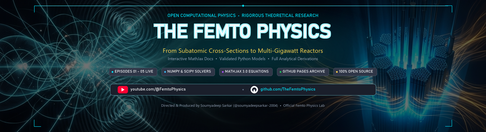

# ⚛️ The Femto Physics Organization

  

### *"Rigorous Theoretical Physics, Faceless Visualizations, Zero Conversational Fluff."*

Welcome to the official GitHub Organization for **[Femto Physics (@FemtoPhysics)](https://www.youtube.com/@FemtoPhysics)** on YouTube.  
This organization hosts open-source physics simulations, peer-reviewed LaTeX calculation preprints, cross-section data libraries, and complete episode production documentation.

---

## 🌐 Live Interactive Portal
Visit the live Docsify documentation hub:  
👉 **[thefemtophysics.github.io/Femto-Physics](https://thefemtophysics.github.io/Femto-Physics/)**

---

## 🔬 Core Repositories & Resources
- **[Femto-Physics/Femto-Physics](https://github.com/TheFemtoPhysics/Femto-Physics)**: Main scientific archive containing complete technical write-ups, mathematical derivations, LaTeX preprints, and embedded YouTube episodes from Episode 01 through Episode 13.
- **[3D Nuclear Core Simulator](https://thefemtophysics.github.io/Femto-Physics/#/simulator)**: Interactive browser-based Three.js core kinetics simulation.

---

## 📺 Complete Episode Series Catalog
- **Episode 01**: *How Nuclear Reactors Actually Work*
- **Episode 02**: *The 0.65% Rule: Why Delayed Neutrons Prevent Instant Explosions*
- **Episode 03**: *Why 2 kg of Uranium Won't Explode in Air (Critical Geometry)*
- **Episode 04**: *Oklo Gabon: Nature's 2-Billion-Year-Old Natural Reactor*
- **Episode 05**: *Fast Breeder Reactor Physics: 30,000 Years of Fuel*
- **Episode 06**: *The 2.6M Barn Xenon Trap: Why Chernobyl Exploded*
- **Episode 07**: *Project Orion: The Starship Powered by Atomic Bombs*
- **Episode 08**: *TerraPower Natrium: Bill Gates' Liquid Metal Sodium SMR*
- **Episode 09**: *The 28,000-Year Battery: Clean Power From Nuclear Waste*
- **Episode 10**: *Why Net Energy Fusion Took 70 Years: The Physics of Ignition*
- **Episode 11**: *The Thorium Conspiracy: Why The Molten Salt Reactor Was Abandoned*
- **Episode 12**: *Direct Fusion Energy: How Helion Generates Electricity Without Steam Turbines*
- **Episode 13**: *Strange Stars & Strangelets: The Particle That Could Eat The Earth*

Directed & Produced by **[Soumyadeep Sarkar](https://github.com/soumyadeepsarkar-2004)**.
