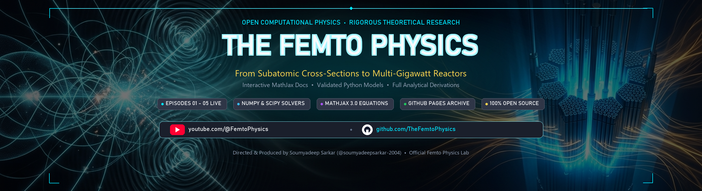

# ⚛️ Femto Physics Documentation & Research Archive

  

> **"Rigorous Theoretical Physics, Faceless Visualizations, Zero Conversational Fluff."**  
> Official YouTube Channel: **[@FemtoPhysics](https://www.youtube.com/@FemtoPhysics)**  
> Directed & Produced by **[Soumyadeep Sarkar](https://github.com/soumyadeepsarkar-2004)**

---

## 📺 Mission & Channel Philosophy
Femto Physics is an open-source science and engineering platform creating university-grade animated physics explainers. We do not dumb down equations or hand-wave the mathematics:

- **Exact Cross-Section Libraries**: All reaction rates derived directly from ENDF/B-VIII.0 and JEFF-3.3 evaluated nuclear data.
- **Python & Open-Source Simulations**: High-density numerical solutions using NumPy, SciPy, and Matplotlib.
- **Dark Slate Aesthetic**: Cinematic `#0a0e17` obsidian background with Cherenkov cyan (`#00e5ff`) and prompt fission amber (`#ffd54f`).
- **Direct YouTube Video Integration**: Every chapter links directly to the full animated production on YouTube.

---

## 📚 Master Episode Directory

| Episode | Title | Key Physics Focus | Status | Link |
| :---: | :--- | :--- | :---: | :---: |
| **01** | **How Nuclear Reactors Actually Work** | Thermal cross-sections, Doppler broadening, delayed neutron precursors | Live | [Read Notes](ep01-how-reactors-work.md) |
| **02** | **The 0.65% Rule** | Delayed neutron fraction ($\beta = 0.0065$), prompt critical jump, point kinetics | Live | [Read Notes](ep02-the-0.65-percent-rule.md) |
| **03** | **Why 2 kg of Uranium Won't Explode** | Critical mass, Fick's Law of diffusion, spherical Helmholtz buckling | Live | [Read Notes](ep03-why-2kg-wont-explode.md) |
| **04** | **Nature's 2-Billion-Year Natural Reactor** | The 1972 French anomaly, Oklo Gabon 3.67% primordial enrichment, geysers | Live | [Read Notes](ep04-oklo-natural-reactor.md) |
| **05** | **Fast Breeder Reactor Physics** | Breeding ratio ($BR > 1.0$), liquid sodium cooling, EBR-II loss-of-flow test | Mastered | [Read Notes](ep05-fast-breeder-reactors.md) |

---

## 🤝 Community & Pull Requests
Have an idea for a future physics deep-dive, found a typo in an equation derivation, or want to contribute a Python simulation?  
Explore our [Contributing Guide](contributing.md) to open an issue or submit a Pull Request!
