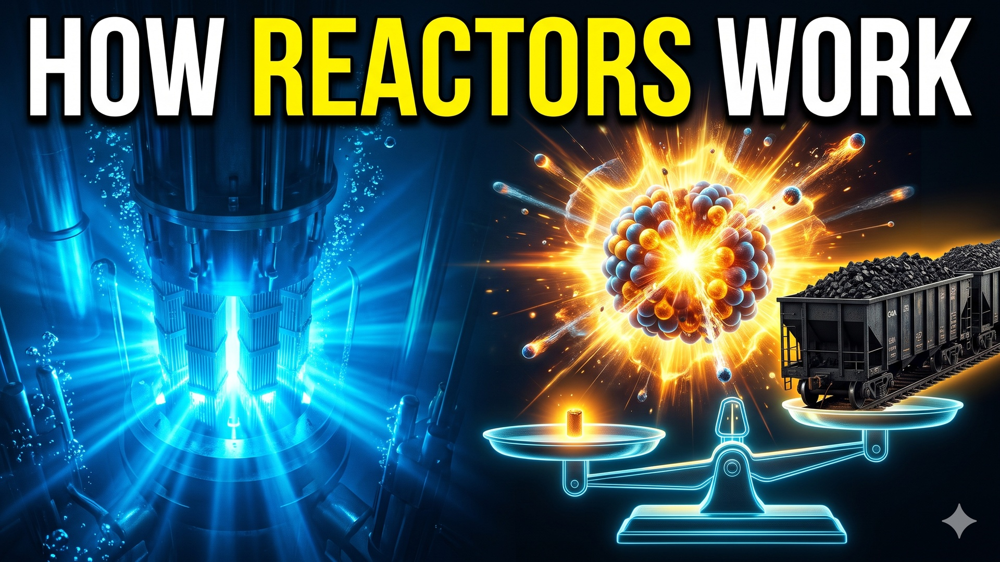

# ⚛️ Episode 01: How Nuclear Reactors Actually Work

  

  <a class="yt-card" href="https://youtu.be/kDhq8UxAiC4" target="_blank">▶ Watch Full Episode 1 on YouTube</a>

---

## 🔬 Core Physical Principles

### 1. Mass Defect & Nuclear Binding Energy
In nuclear fission, mass is directly converted into kinetic energy via Einstein's mass-energy equivalence:

$$\Delta m = Z m_p + (A - Z) m_n - M_{\text{nucleus}}$$

$$E_b = \Delta m \cdot c^2$$

Fissioning one single atom of $^{235}\text{U}$ releases ~200 MeV of energy:
- **165 MeV**: Kinetic energy of fission fragments.
- **5 MeV**: Prompt neutron kinetic energy.
- **7 MeV**: Prompt gamma rays.
- **23 MeV**: Delayed beta, neutrino, and gamma emissions.

Fissioning just **1.05 kilograms of Uranium-235** produces 1,000 Megawatts of continuous thermal power for 24 hours.

---

### 2. Microscopic & Macroscopic Cross-Sections
$$\Sigma_t(E) = \sum_i N_i \left( \sigma_{f,i}(E) + \sigma_{\gamma,i}(E) + \sigma_{s,i}(E) \right)$$

Where:
- $\Sigma_t$: Total macroscopic cross-section ($\text{cm}^{-1}$).
- $N_i$: Nuclear number density ($\text{atoms}/\text{cm}^3$).
- $\sigma$: Microscopic cross-section ($\text{Barns}$, $1\text{ b} = 10^{-24}\text{ cm}^2$).

---

### 3. Doppler Resonance Broadening: The Inherent Safety Brake
As fuel temperature rises, thermal motion of target nuclei broadens the narrow neutron capture resonance peaks:

$$\sigma_D(E, T) = \frac{\sigma_0}{\sqrt{4\pi \Delta^2}} \int_{-\infty}^{\infty} \exp\left(-\frac{(E - E')^2}{4\Delta^2}\right) \frac{dE'}{1 + 4\left(\frac{E' - E_0}{\Gamma}\right)^2}$$

Where the Doppler width $\Delta = \sqrt{\frac{4 k_B T E}{A}}$.  
This automatically increases parasitic resonance capture in fertile $^{238}\text{U}$, introducing instant negative reactivity feedback ($\alpha_D < 0$) that prevents prompt runaway.

---

  <a class="yt-card" href="https://youtu.be/kDhq8UxAiC4" target="_blank">▶ Watch Full Episode 1 on YouTube</a>

