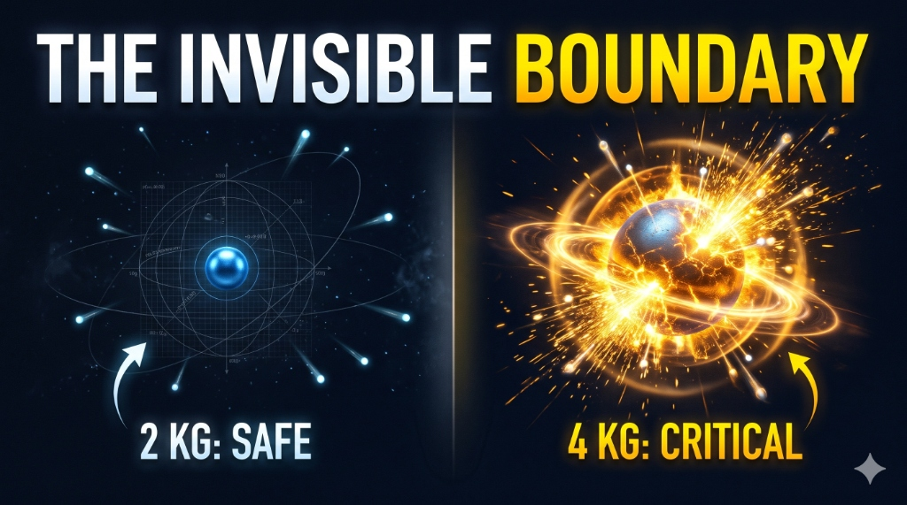
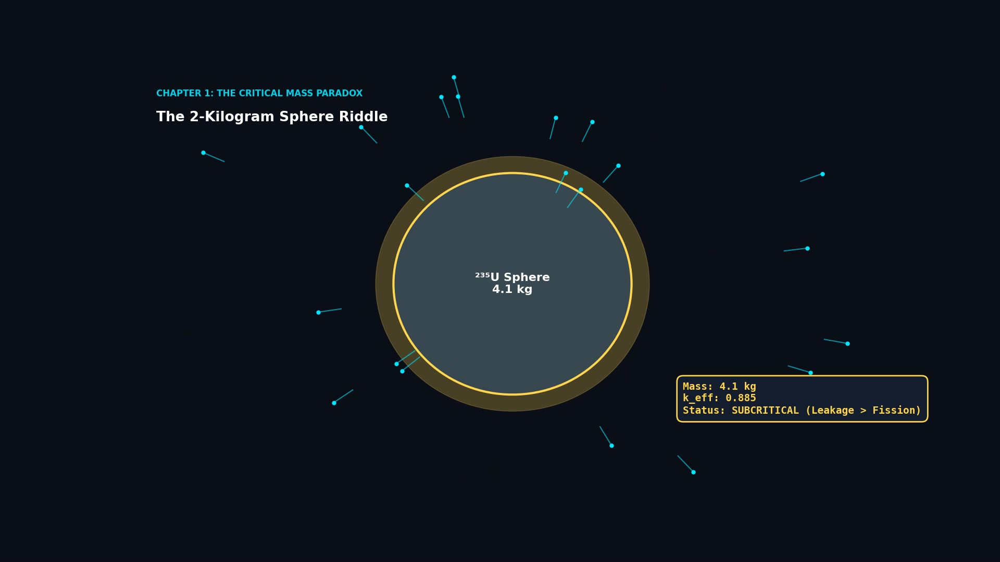
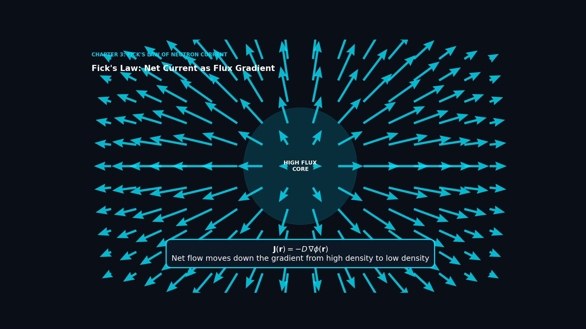

# ⚛️ Episode 03: Why 2 kg of Uranium Won't Explode: Critical Mass & Neutron Diffusion

  <iframe src="https://www.youtube-nocookie.com/embed/Vbffws45SBI" style="position: absolute; top: 0; left: 0; width: 100%; height: 100%; border:0;" allowfullscreen></iframe>

  <h3 style="color: #00e5ff; margin-top: 0; display: flex; align-items: center; gap: 8px;">🧠 Interactive Knowledge Check (Pop Quiz #03)</h3>
  
A bare 2 kg sphere of pure U-235 is completely safe in open air. What happens if you drop it into a bucket of water?

  <ul style="list-style-type: none; padding-left: 0; margin: 15px 0;">
    <li style='padding: 8px 12px; margin-bottom: 6px; background: rgba(30, 41, 59, 0.6); border-radius: 6px; border: 1px solid rgba(255,255,255,0.08);'>[A] It dissolves harmlessly like sodium chloride</li>
    <li style='padding: 8px 12px; margin-bottom: 6px; background: rgba(30, 41, 59, 0.6); border-radius: 6px; border: 1px solid rgba(255,255,255,0.08);'>[B] Water acts as a moderator and reflector, causing a lethal criticality flash ✅</li>
    <li style='padding: 8px 12px; margin-bottom: 6px; background: rgba(30, 41, 59, 0.6); border-radius: 6px; border: 1px solid rgba(255,255,255,0.08);'>[C] Water extinguishes the nuclear reaction completely</li>
    <li style='padding: 8px 12px; margin-bottom: 6px; background: rgba(30, 41, 59, 0.6); border-radius: 6px; border: 1px solid rgba(255,255,255,0.08);'>[D] The sphere immediately turns into lead</li>
  </ul>
  

    
💡 Reveal Detailed Scientific Explanation & Timestamp

    

      <strong>Explanation:</strong> Hydrogen in water thermalizes leaking fast neutrons and reflects them back into the core, slashing critical mass from 52 kg down to <1 kg and triggering immediate prompt criticality. 
      <strong>Video Timestamp:</strong> Check <code>[03:40]</code> in the video for the mathematical derivation!
    

  

---

  

  <a class="yt-card" href="https://youtu.be/Vbffws45SBI" target="_blank">▶ Watch Full Episode 3 on YouTube</a>

---

## 🔬 Core Physical Principles

### 1. The Geometry of Criticality
Why can a 52-kilogram sphere of pure Uranium-235 sustain a self-sustaining chain reaction, while a 2-kilogram sphere remains completely inert?

Criticality is an unyielding mathematical competition between:
- **Volume Production**: Fissions generating neutrons proportional to volume ($V \propto R^3$).
- **Surface Area Leakage**: Fast neutrons escaping out the boundary proportional to surface area ($A \propto R^2$).

As radius $R$ expands, the volume-to-surface ratio increases ($V/A = R/3$), until neutron generation overtakes boundary leakage.

  

---

### 2. Fick's Law of Neutron Diffusion
Neutron migration through dense fissile media obeys Fick's first law:

$$\mathbf{J}(\mathbf{r}) = -D \nabla \phi(\mathbf{r})$$

Where:
- $\mathbf{J}$ = Neutron current vector ($\text{neutrons}/\text{cm}^2\cdot\text{s}$).
- $D$ = Diffusion coefficient ($D \approx \frac{1}{3 \Sigma_{tr}}$).
- $\phi(\mathbf{r})$ = Neutron scalar flux.

  

---

### 3. The Helmholtz Wave Equation & Material Buckling
Combining Fick's law with the neutron continuity balance yields the fundamental steady-state diffusion equation:

$$\nabla^2 \phi(\mathbf{r}) + B_m^2 \phi(\mathbf{r}) = 0$$

Where $B_m^2$ is the **Material Buckling**:

$$B_m^2 = \frac{\frac{\nu \Sigma_f}{k} - \Sigma_a}{D}$$

For a bare spherical core, the spatial Laplacian in spherical coordinates gives:

$$\frac{1}{r^2} \frac{d}{dr} \left( r^2 \frac{d\phi}{dr} \right) + B^2 \phi(r) = 0 \implies \phi(r) = \phi_0 \frac{\sin(B_g r)}{B_g r}$$

Enforcing the zero-flux extrapolated boundary condition at $\tilde{R} = R_c + 0.71 \lambda_{tr}$ reveals the exact critical radius:

$$R_c = \frac{\pi}{B_m} - 0.71 \lambda_{tr}$$

$$M_c = \frac{4}{3} \pi R_c^3 \rho$$

---

  <a class="yt-card" href="https://youtu.be/Vbffws45SBI" target="_blank">▶ Watch Full Episode 3 on YouTube</a>

