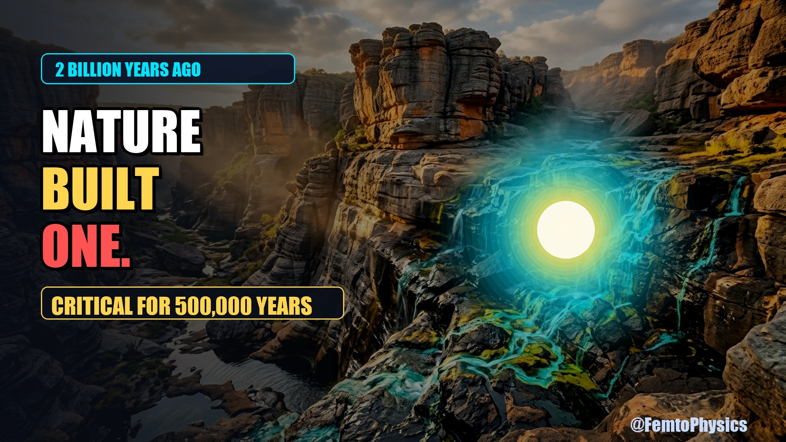
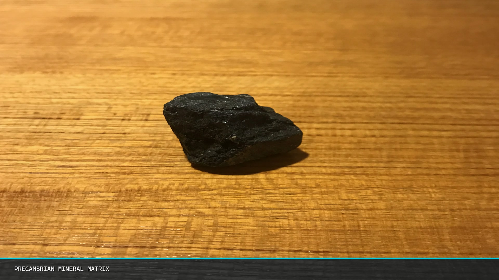
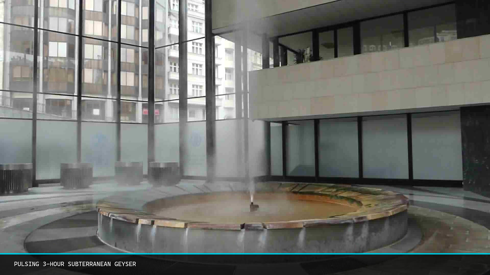
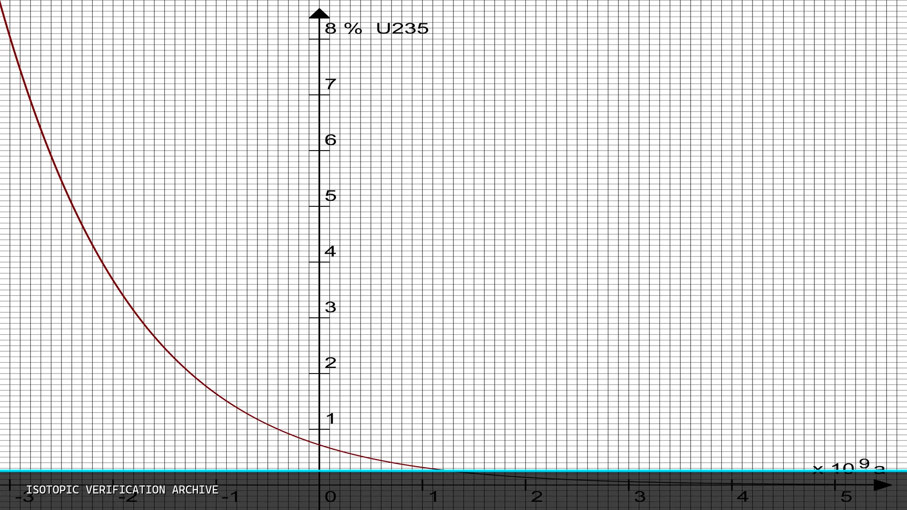

# ⚛️ Episode 04: Nature's 2-Billion-Year Natural Nuclear Reactor

  <iframe src="https://www.youtube-nocookie.com/embed/FxmxHrUERVw" style="position: absolute; top: 0; left: 0; width: 100%; height: 100%; border:0;" allowfullscreen></iframe>

  <h3 style="color: #00e5ff; margin-top: 0; display: flex; align-items: center; gap: 8px;">🧠 Interactive Knowledge Check (Pop Quiz #04)</h3>
  
Why could a natural nuclear reactor start up in Gabon 2 billion years ago, but can NEVER happen in nature today?

  <ul style="list-style-type: none; padding-left: 0; margin: 15px 0;">
    <li style='padding: 8px 12px; margin-bottom: 6px; background: rgba(30, 41, 59, 0.6); border-radius: 6px; border: 1px solid rgba(255,255,255,0.08);'>[A] Earth's gravity was twice as strong back then</li>
    <li style='padding: 8px 12px; margin-bottom: 6px; background: rgba(30, 41, 59, 0.6); border-radius: 6px; border: 1px solid rgba(255,255,255,0.08);'>[B] Natural U-235 was 3.7% enriched (due to shorter half-life), but is only 0.72% today ✅</li>
    <li style='padding: 8px 12px; margin-bottom: 6px; background: rgba(30, 41, 59, 0.6); border-radius: 6px; border: 1px solid rgba(255,255,255,0.08);'>[C] Ancient groundwater was 100% heavy water (deuterium)</li>
    <li style='padding: 8px 12px; margin-bottom: 6px; background: rgba(30, 41, 59, 0.6); border-radius: 6px; border: 1px solid rgba(255,255,255,0.08);'>[D] Atmospheric nitrogen acted as a natural control rod</li>
  </ul>
  

    
💡 Reveal Detailed Scientific Explanation & Timestamp

    

      <strong>Explanation:</strong> Two billion years ago, faster decay of U-235 (half-life 704M yrs) vs U-238 (4.47B yrs) meant natural uranium was ~3.7% U-235, matching modern reactor fuel! 
      <strong>Video Timestamp:</strong> Check <code>[01:45]</code> in the video for the mathematical derivation!
    

  

---

  

  <a class="yt-card" href="https://youtu.be/FxmxHrUERVw" target="_blank">▶ Watch Full Episode 4 on YouTube</a>

---

## 🔬 Core Physical Principles

### 1. The 1972 French Enrichment Mystery
In May 1972, mass spectrometry at the Pierrelatte uranium enrichment plant in France detected an inexplicable deficit in Uranium-235:
- **Universal Solar Abundance**: $0.7202\% \pm 0.0006\%$
- **Oklo Gabon Sample**: $0.7171\%$
- **Missing Fissile Mass**: Over 200 kg of U-235 was absent from the ore deposit, triggering an immediate military investigation into clandestine weapons diversion.

  

---

### 2. Time-Reversal & Primordial Enrichment
Because $^{235}\text{U}$ decays significantly faster than $^{238}\text{U}$ ($T_{1/2}^{235} = 7.04 \times 10^8\text{ yr}$ vs $T_{1/2}^{238} = 4.47 \times 10^9\text{ yr}$), the primordial isotopic ratio was drastically higher 2 billion years ago:

$$R(t) = \frac{N_{235}(0) e^{-\lambda_{235} t}}{N_{238}(0) e^{-\lambda_{238} t}}$$

$$R(-2.0\text{ Ga}) \approx 3.67\%$$

This $3.67\%$ enrichment matches modern commercial pressurized water reactor fuel, allowing natural groundwater to serve as a sufficient moderator for criticality.

  

---

### 3. The 3-Hour Geyser Cycle
The natural reactor stabilized itself through passive thermodynamic negative void feedback:
1. Groundwater infiltered the rich sandstone uranium veins, moderating fast neutrons and initiating critical chain reactions.
2. Heat accumulated, boiling the water into steam.
3. Steam has low density; neutron moderation collapsed, terminating criticality ($\alpha_v = \partial \rho / \partial v < 0$).
4. The core cooled over 2.5 hours, water re-entered, and the cycle repeated for hundreds of thousands of years.

  

---

### 4. Fission Product Fingerprints
Definitive proof of fission was discovered in anomalous isotopic ratios of rare earth neodymium ($^{143}\text{Nd}/^{142}\text{Nd}$) and samarium ($^{149}\text{Sm}$), proving that nature operated 16 natural fission zones producing ~100 kW average thermal power.

  

---

  <a class="yt-card" href="https://youtu.be/FxmxHrUERVw" target="_blank">▶ Watch Full Episode 4 on YouTube</a>

