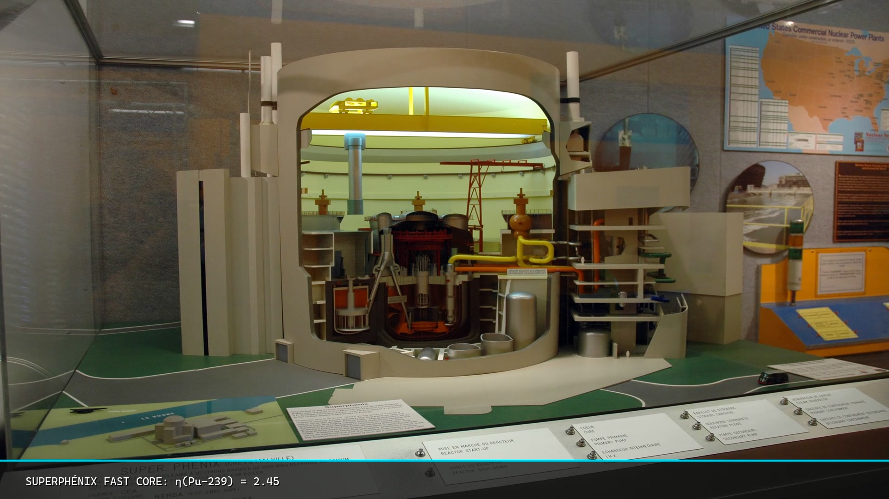
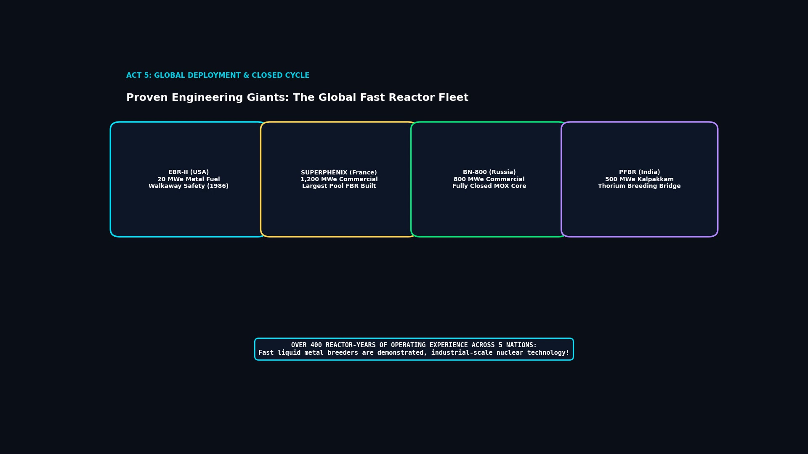

# ⚛️ Episode 05: The Machine That Makes More Fuel Than It Burns: Fast Breeder Reactors

  <iframe src="https://www.youtube-nocookie.com/embed/rgPuJdilhgs" style="position: absolute; top: 0; left: 0; width: 100%; height: 100%; border:0;" allowfullscreen></iframe>

  <h3 style="color: #00e5ff; margin-top: 0; display: flex; align-items: center; gap: 8px;">🧠 Interactive Knowledge Check (Pop Quiz #05)</h3>
  
Why must Fast Breeder Reactors banish water completely and use liquid sodium metal instead?

  <ul style="list-style-type: none; padding-left: 0; margin: 15px 0;">
    <li style='padding: 8px 12px; margin-bottom: 6px; background: rgba(30, 41, 59, 0.6); border-radius: 6px; border: 1px solid rgba(255,255,255,0.08);'>[A] Water reacts violently with pure uranium</li>
    <li style='padding: 8px 12px; margin-bottom: 6px; background: rgba(30, 41, 59, 0.6); border-radius: 6px; border: 1px solid rgba(255,255,255,0.08);'>[B] Water's hydrogen slows neutrons down, dropping the Plutonium breeding factor below 2.0 ✅</li>
    <li style='padding: 8px 12px; margin-bottom: 6px; background: rgba(30, 41, 59, 0.6); border-radius: 6px; border: 1px solid rgba(255,255,255,0.08);'>[C] Sodium conducts electricity through the fuel rods</li>
    <li style='padding: 8px 12px; margin-bottom: 6px; background: rgba(30, 41, 59, 0.6); border-radius: 6px; border: 1px solid rgba(255,255,255,0.08);'>[D] Water cannot survive temperatures above 100°C</li>
  </ul>
  

    
💡 Reveal Detailed Scientific Explanation & Timestamp

    

      <strong>Explanation:</strong> Breeding Pu-239 from U-238 requires eta > 2.0. Light water slows neutrons to thermal speeds where eta drops to ~1.7, extinguishing fuel breeding. 
      <strong>Video Timestamp:</strong> Check <code>[02:56]</code> in the video for the mathematical derivation!
    

  

---

  

  <a class="yt-card" href="https://www.youtube.com/@FemtoPhysics" target="_blank">▶ Watch Full Episode on YouTube</a>

---

## 🔬 Core Physical Principles

### 1. The Thermodynamic Paradox & The Once-Through Absurdity
Commercial light-water reactors operate on a once-through fuel cycle:
- **0.7% Fissile U-235**: Enriched up to 3–5% for commercial power.
- **99.3% Fertile U-238**: Discharged into spent fuel pools after fissioning only a tiny fraction of total potential energy.

A **Fast Breeder Reactor (FBR)** does not create energy from nothing. It transforms inert fertile Uranium-238 into fissile Plutonium-239 via continuous neutron capture:

$$^{238}\text{U} + n \longrightarrow \,^{239}\text{U} \xrightarrow[\beta^-]{23.5\text{ min}} \,^{239}\text{Np} \xrightarrow[\beta^-]{2.35\text{ days}} \,^{239}\text{Pu}$$

  

---

### 2. The Breeding Ratio Equation
To breed more fuel than consumed, the Breeding Ratio ($BR$) must strictly exceed 1.0:

$$BR = \frac{\text{Fissile Atoms Produced}}{\text{Fissile Atoms Consumed}} = \eta - 1 - L$$

Where:
- $\eta$ (Eta) = Average number of fission neutrons emitted per neutron absorbed in fissile fuel:
  $$\eta = \nu \frac{\sigma_f}{\sigma_a} = \nu \frac{\sigma_f}{\sigma_f + \sigma_\gamma}$$
- $L$ = Parasitic neutron loss fraction (leakage + non-productive structural capture).

  

#### The Thermal Neutron Deficit vs Fast Spectrum Surge:
- In thermal reactors ($E_n \approx 0.025\text{ eV}$):
  $$\eta(^{235}\text{U}) \approx 2.07 \implies BR \approx 0.6 \text{ (Net Fissile Loss)}$$
- In fast reactors ($E_n > 0.1\text{ MeV}$):
  $$\eta(^{239}\text{Pu}) \approx 2.45 \implies BR \approx 1.25 \text{ (Surplus Breeding Margin)}$$

  

---

### 3. Coolant Physics: Why Liquid Sodium Metal?
Water contains hydrogen atoms ($A=1$), which moderate fast neutrons in single elastic collisions. Fast breeders eliminate water and utilize **liquid sodium metal ($^{23}\text{Na}$)**:
- **Atomic Mass ($A=23$)**: Loses only ~8% kinetic energy per elastic collision, maintaining the fast spectrum.
- **High Boiling Point ($883^\circ\text{C}$)**: Operates at atmospheric pressure (1 atm) with zero explosive steam risk.
- **Ultra-High Thermal Conductivity**:
  $$k_{\text{Na}} = 86\text{ W/m}\cdot\text{K} \quad \text{vs} \quad k_{\text{H}_2\text{O}} = 0.6\text{ W/m}\cdot\text{K}$$

  

---

### 4. The April 3, 1986 EBR-II Meltdown Test (SHRT-45R)
Twenty-three days before Chernobyl, engineers in Idaho subjected Experimental Breeder Reactor II (EBR-II) to the ultimate loss-of-flow test:
- **Operating Power**: 100% full thermal power (62.5 MWt).
- **Test Protocol**: Primary sodium pumps cut, all scram control rods deliberately disabled.
- **Physical Result**: Core thermal expansion caused mechanical fuel rod bowing outward, widening neutron leakage paths.
- **Negative Reactivity Feedback**:
  $$\alpha_T = \frac{\partial \rho}{\partial T} < 0$$
- **Outcome**: The chain reaction halted itself in under 300 seconds through the pure laws of thermodynamics without human or computer intervention.

---

### 5. Closed-Loop Pyroprocessing & Waste Radiotoxicity
Using molten-salt electrorefining at $500^\circ\text{C}$, minor actinides (Americium, Curium, Neptunium) are recycled back into the fast reactor and incinerated via fission.

$$\text{Waste Radiotoxicity Lifetime: } 300,000 \text{ Years} \longrightarrow 300 \text{ Years}$$

  

---

  <a class="yt-card" href="https://www.youtube.com/@FemtoPhysics" target="_blank">▶ Watch Full Episode 5 on YouTube</a>

