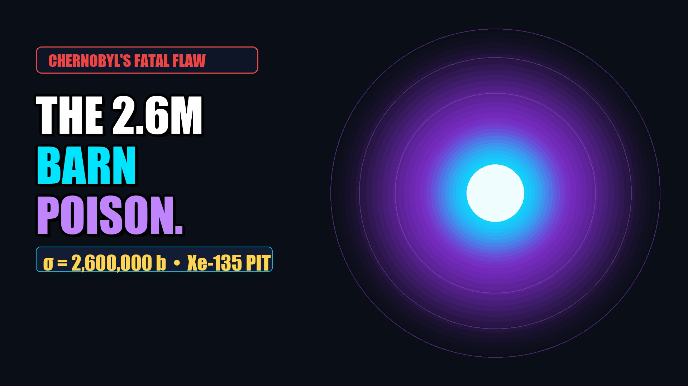

# ⚛️ Episode 06: The 2.6-Million-Barn Poison That Doomed Chernobyl: Xenon-135

<p align="center">
  
</p>

<p align="center">
  <a class="yt-card" href="https://youtu.be/bKB7p6MTshY" target="_blank">▶ Watch Full Episode on YouTube</a>
</p>

---

## 🔬 Core Physical Principles

### 1. The Astronomical Cross-Section of Xenon-135
Nuclear reaction cross-sections quantify the effective target area a nucleus presents to an incident particle, measured in **barns** ($1\text{ b} = 10^{-28}\text{ m}^2 = 10^{-24}\text{ cm}^2$).

While Uranium-235 has a thermal absorption cross-section of **580 barns**, Xenon-135 possesses a colossal resonance absorption cross-section of:

$$\sigma_a(^{135}\text{Xe}) = 2,600,000\text{ barns}$$

This makes Xenon-135 **4,480 times larger** than the fuel itself to thermal neutrons. It acts as an unyielding quantum sponge, devouring neutrons via radiative capture:

$$^{135}\text{Xe} + \,^1n \longrightarrow \,^{136}\text{Xe} + \gamma$$

Where $^{136}\text{Xe}$ is completely stable with a trivial cross-section ($\approx 0.26\text{ b}$).

---

### 2. The Coupled Bateman Decay Differential Equations
Xenon-135 is produced via two mechanisms:
1. **Direct Fission Yield**: $\gamma_{\text{Xe}} = 0.28\%$ (minor contribution).
2. **Iodine-135 Beta Decay**: $\gamma_{\text{I}} = 6.1\%$ (massive precursor reservoir).

$$^{135}\text{Te} \xrightarrow[\beta^-]{19\text{ s}} \,^{135}\text{I} \xrightarrow[\beta^-]{6.57\text{ hr}} \,^{135}\text{Xe} \xrightarrow[\beta^-]{9.14\text{ hr}} \,^{135}\text{Cs}$$

The coupled rate equations governing their concentrations are:

$$\frac{dI(t)}{dt} = \gamma_I \Sigma_f \phi(t) - \lambda_I I(t)$$

$$\frac{dXe(t)}{dt} = \gamma_{Xe} \Sigma_f \phi(t) + \lambda_I I(t) - \lambda_{Xe}Xe(t) - \sigma_a^{Xe}\phi(t)Xe(t)$$

Where:
- $\lambda_I = \frac{\ln 2}{T_{1/2}(I)} = 2.87 \times 10^{-5}\text{ s}^{-1}$
- $\lambda_{Xe} = \frac{\ln 2}{T_{1/2}(Xe)} = 2.09 \times 10^{-5}\text{ s}^{-1}$
- $\sigma_a^{Xe} = 2.6 \times 10^{-18}\text{ cm}^2$ ($2.6 \times 10^6\text{ b}$)
- $\phi(t)$ = Thermal neutron flux ($\text{n}\cdot\text{cm}^{-2}\text{s}^{-1}$)

---

### 3. The Steady-State Equilibrium & The Power Drop Ambush

At full steady-state power ($\phi = 10^{14}\text{ n/cm}^2\text{s}$), the neutron burnout rate overwhelms radioactive decay ($\sigma_a^{Xe}\phi \gg \lambda_{Xe}$):

$$Xe_{\text{eq}} = \frac{(\gamma_I + \gamma_{Xe})\Sigma_f \phi}{\lambda_{Xe} + \sigma_a^{Xe}\phi} \approx \frac{\gamma_I + \gamma_{Xe}}{\sigma_a^{Xe}}\frac{\Sigma_f}{\text{const}}$$

When reactor power plunges to near-zero:
1. Neutron flux collapses ($\phi \to 0$).
2. The destruction term $\sigma_a^{Xe}\phi Xe$ drops instantly to zero.
3. The vast Iodine reservoir ($T_{1/2} = 6.57\text{ hr}$) continues pumping Xenon-135 into the fuel unabated.

This creates the notorious **Xenon Pit**: Xenon concentration peaks **11 hours** after shutdown, introducing over $-30,000\text{ pcm}$ ($-30\%$) of negative reactivity into the core.

---

### 4. Forensic Timeline of Chernobyl Unit 4 (April 25–26, 1986)

| Timestamp | Operational Event | Core Reactivity Impact |
| :--- | :--- | :--- |
| **14:00 (Apr 25)** | Power held at 50% (1,600 MWth) for 9 hours | Massive $^{135}\text{I}$ inventory accumulates in fuel |
| **00:05 (Apr 26)** | Power drop ordered from 700 MWth; plunges to 30 MWth | Core stalls into deep Xenon pit trap |
| **00:30–01:00** | Operators withdraw 205 of 211 control rods | ORM collapses to 6–8 rods (legal limit: 30) |
| **01:23:04** | Turbine test begins; coolant flow drops, boiling starts | Positive void coefficient ($\alpha_v > 0$) injects reactivity |
| **01:23:40** | Akimov presses **AZ-5** Emergency SCRAM | Graphite displacer tips enter core bottom |
| **01:23:44** | Core reaches Prompt Critical ($k_{\text{eff}} > 1 + \beta$) | Power surges to 33,000 MWth; steam explosion blows 1,000-ton lid |

---

### 5. Inherent Safety Contrast: Why Fast Reactors Cannot Suffer Xenon Pits

In fast breeder reactors (such as EBR-II and PRISM), fission neutrons maintain an average kinetic energy of $E_n > 0.1\text{ MeV}$.

At MeV energy levels, the quantum absorption resonance of Xenon-135 collapses:

$$\sigma_a^{\text{fast}}(^{135}\text{Xe}) < 1\text{ barn}$$

Fast spectrum reactors are **100% immune** to Xenon poisoning, eliminating the pit trap entirely by fundamental physical laws.

---

## 💻 Simulation & Reproduction Code

Interactive Python simulation of the coupled Bateman kinetics:
```python
import numpy as np
import matplotlib.pyplot as plt

# Bateman constants
gamma_I = 0.061
gamma_Xe = 0.0028
lambda_I = np.log(2) / (6.57 * 3600)   # 2.87e-5 s^-1
lambda_Xe = np.log(2) / (9.14 * 3600)  # 2.09e-5 s^-1
sigma_Xe = 2.6e-18                     # 2.6M barns in cm^2
phi_full = 1e14                        # Full power flux

# Time array: 40 hours after shutdown
hours = np.linspace(0, 40, 500)
t = hours * 3600

# Steady-state values prior to shutdown
I_0 = (gamma_I * phi_full) / lambda_I
Xe_0 = ((gamma_I + gamma_Xe) * phi_full) / (lambda_Xe + sigma_Xe * phi_full)

# Post-shutdown solutions (phi = 0)
I_t = I_0 * np.exp(-lambda_I * t)
Xe_t = Xe_0 * np.exp(-lambda_Xe * t) + (lambda_I / (lambda_Xe - lambda_I)) * I_0 * (np.exp(-lambda_I * t) - np.exp(-lambda_Xe * t))

plt.figure(figsize=(10, 5), facecolor='#0a0e17')
plt.plot(hours, Xe_t / Xe_0, color='#00e5ff', lw=2.5, label='Xenon-135 Relative Concentration')
plt.axvline(11.1, color='#ff5252', linestyle='--', label='Peak Poison Depth (11.1 Hours)')
plt.title('Chernobyl Post-Shutdown Xenon Pit Transient', color='white')
plt.xlabel('Hours After Power Drop', color='white')
plt.ylabel('Xe-135 / Xe_eq', color='white')
plt.legend()
plt.grid(True, alpha=0.3)
plt.show()
```
