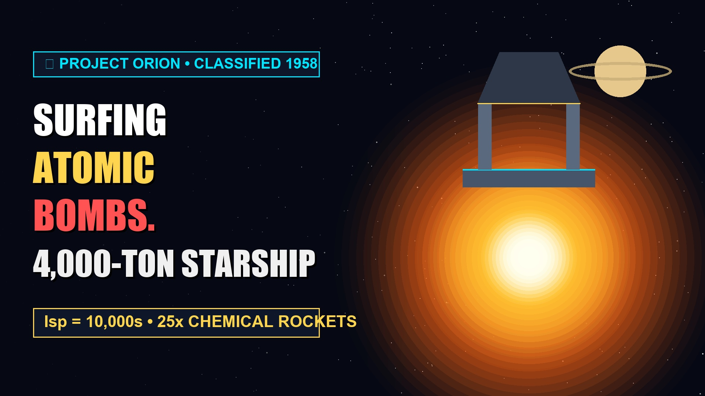

# 🚀 Episode 07: Project Orion: How to Propel a 4,000-Ton Spacecraft with Nuclear Bombs


<div style="background: rgba(15, 23, 42, 0.85); border: 1.5px solid #00e5ff; border-radius: 12px; padding: 20px; margin: 25px 0; box-shadow: 0 8px 24px rgba(0, 229, 255, 0.15);">
  <h3 style="color: #00e5ff; margin-top: 0; display: flex; align-items: center; gap: 8px;">🧠 Interactive Knowledge Check (Pop Quiz #07)</h3>
  <p style="font-size: 1.1em; color: #f8fafc; font-weight: 600;">When a nuclear bomb detonated 30 meters behind the 4,000-ton Orion spacecraft, how did the steel pusher plate survive the 1,000,000 K plasma fireball without vaporizing?</p>
  <ul style="list-style-type: none; padding-left: 0; margin: 15px 0;">
    <li style='padding: 8px 12px; margin-bottom: 6px; background: rgba(30, 41, 59, 0.6); border-radius: 6px; border: 1px solid rgba(255,255,255,0.08);'>[A] The plate was refrigerated with liquid helium</li>
    <li style='padding: 8px 12px; margin-bottom: 6px; background: rgba(30, 41, 59, 0.6); border-radius: 6px; border: 1px solid rgba(255,255,255,0.08);'>[B] The blast was magnetic and contained no heat</li>
    <li style='padding: 8px 12px; margin-bottom: 6px; background: rgba(30, 41, 59, 0.6); border-radius: 6px; border: 1px solid rgba(255,255,255,0.08);'>[C] A microscopic oil spray flash-ablated into a protective Leidenfrost gas cushion ✅</li>
    <li style='padding: 8px 12px; margin-bottom: 6px; background: rgba(30, 41, 59, 0.6); border-radius: 6px; border: 1px solid rgba(255,255,255,0.08);'>[D] The ship moved away at the speed of light</li>
  </ul>
  <details style="margin-top: 12px; cursor: pointer; background: rgba(2, 132, 199, 0.15); border-left: 4px solid #38bdf8; padding: 10px 15px; border-radius: 4px;">
    <summary style="color: #ffd54f; font-weight: bold; outline: none;">💡 Reveal Detailed Scientific Explanation & Timestamp</summary>
    <p style="margin-top: 10px; color: #e2e8f0; font-size: 0.95em; line-height: 1.6;">
      <strong>Explanation:</strong> Leidenfrost oil ablation! A thin film of silicone oil flash-ablated into an opaque, high-density stagnation layer that insulated the steel plate.<br>
      <strong>Video Timestamp:</strong> Check <code>[03:22]</code> in the video for the mathematical derivation!
    </p>
  </details>
</div>

---

<p align="center">
  
</p>

---

## 🔬 Core Physical Principles

### 1. The Tyranny of the Tsiolkovsky Rocket Equation
All chemical propulsion is governed by the ideal rocket equation formulated by Konstantin Tsiolkovsky in 1903:

$$\Delta v = v_e \ln\left(\frac{m_0}{m_f}\right) = I_{sp} \cdot g_0 \cdot \ln\left(\frac{m_0}{m_f}\right)$$

Where:
- $\Delta v$ is the total velocity increment achievable.
- $v_e$ is the effective exhaust velocity.
- $I_{sp} = \frac{v_e}{g_0}$ is the specific impulse in seconds ($g_0 = 9.80665\text{ m/s}^2$).
- $\frac{m_0}{m_f}$ is the mass ratio (initial wet mass over final dry payload mass).

Inverting this equation reveals the exponential penalty imposed by low exhaust velocity:

$$\frac{m_0}{m_f} = e^{\frac{\Delta v}{I_{sp} \cdot g_0}}$$

For chemical reactions, energy density is strictly bounded by molecular electron-orbital rearrangement ($\sim 2\text{ to }5\text{ eV}$ per chemical bond). For the highest-energy chemical propellant known—liquid hydrogen and liquid oxygen ($\text{LH}_2 / \text{LOX}$)—the theoretical maximum specific impulse is capped at **450 seconds** ($v_e \approx 4.4\text{ km/s}$).

To execute a high-speed round trip to Mars ($\Delta v \approx 25\text{ km/s}$):
- **Chemical Rocket ($I_{sp} = 450\text{ s}$)**: $\frac{m_0}{m_f} = e^{\frac{25000}{450 \times 9.81}} = e^{5.66} \approx 287$. For every ton of payload returned, 286 tons of propellant must be carried!
- **Project Orion ($I_{sp} = 10,000\text{ s}$)**: $\frac{m_0}{m_f} = e^{\frac{25000}{10000 \times 9.81}} = e^{0.255} \approx 1.29$. The propellant mass is only **29% of the dry ship mass**!

---

### 2. The Metallurgical Wall of Solid-Core Nuclear Thermal Propulsion (NERVA)
Solid-core nuclear thermal rockets (such as NERVA) replace chemical combustion with a solid fission reactor core heating liquid hydrogen propellant:

$$I_{sp} \propto \sqrt{\frac{T_{\text{chamber}}}{M_{\text{propellant}}}}$$

Because molecular hydrogen has the lowest possible molecular weight ($M = 2\text{ g/mol}$), NERVA doubled the specific impulse to **900 seconds** ($v_e \approx 8.8\text{ km/s}$).

However, NERVA collided with an absolute metallurgical wall: **The core must operate hotter than the gas it exhausts.** Uranium carbide fuel elements and refractory graphite structures lose structural integrity and sublimate at $\sim 3,000\text{ to }3,300\text{ K}$. Running the propellant hotter melts the engine from within.

---

### 3. Stanislaw Ulam's Breakthrough: External Pulse Propulsion
In 1947, mathematician Stanislaw Ulam at Los Alamos proposed circumventing metallurgical limits entirely:
> *Do not bottle the reaction inside an engine chamber. Throw the nuclear reaction outside the spacecraft, where plasma temperatures can reach $10,000,000\text{ K}$, and capture the expanding kinetic shockwave.*

Because the blast occurs in free space, thermal interaction with the spacecraft lasts less than a millisecond. Structural materials never reach equilibrium temperature with the nuclear plasma.

---

## 🛠️ Anatomy of a Nuclear Pulse Unit (NPU)

Project Orion could not use standard isotropic atomic weapons. In empty space without an atmosphere, a spherical explosion radiates $90\%$ of its energy uselessly into the cosmic void.

Under Ted Taylor at General Atomics, the team designed the **Nuclear Pulse Unit (NPU)**—the first shaped-charge thermonuclear device:

```
[ Primary Fission Trigger ]
         │ (Soft X-ray Implosion Flash)
         ▼
[ Beryllium Oxide (BeO) Radiation Lens ]
         │ (Channeling Radiation Forward)
         ▼
[ High-Z Tungsten Propellant Disk (W-74) ]
         │ (Instantaneous Flash Vaporization)
         ▼
[ Collimated Hyper-Velocity Plasma Jet (120 km/s) ]
```

1. **Radiation Channeling**: Trillions of soft X-rays from the primary detonation flash across a low-density beryllium oxide ($\text{BeO}$) channel filler before hydrodynamic expansion begins ($t < 10^{-8}\text{ s}$).
2. **Tungsten Propellant Disk**: A dense slab of tungsten ($Z=74$, $\rho = 19.3\text{ g/cm}^3$) absorbs the intense X-ray flux, flashing instantly into an ultra-dense, forward-collimated plasma slug.
3. **Collimated Jet Dynamics**: The BeO radiation casing directs $>80\%$ of total explosion momentum into a narrow $22.5^\circ$ forward cone directed squarely at the ship's pusher plate.
4. **Exhaust Velocity**: The tungsten plasma strikes outward at **$120\text{ km/s}$**, producing an effective specific impulse of **$10,000\text{ seconds}$** ($25\times$ chemical rocketry).

---

## 🛡️ Pusher Plate Mechanics & The Leidenfrost Shield

### Stagnation Pressure & Pulse Duration
At a standoff distance of **30 meters**, the collimated tungsten plasma wave impacts the 40-meter-diameter steel pusher plate with:
- Stagnation pressure: $\sim 10^7\text{ atmospheres}$ ($1\text{ TPa}$).
- Pulse impact duration: $\Delta \tau \approx 300\ \mu\text{s}$ ($0.0003\text{ seconds}$).
- Instantaneous acceleration: $a_{\text{inst}} \approx 10,000\text{ Gs}$.

### Why Didn't the Plate Vaporize?
A million-degree plasma would vaporize exposed structural steel in milliseconds. The Orion engineers solved this through **flash-ablation Leidenfrost shielding**:
- Prior to each detonation, mechanical nozzles spray a microscopic $0.1\text{ mm}$ film of heavy silicone oil across the pusher plate face.
- The initial radiative fireball flash strikes the oil film, vaporizing it into an opaque, insulating ionized gas cushion.
- Under the Leidenfrost effect, this boundary layer prevents the hot plasma from contacting the steel substrate.
- In underground nuclear tests at the Nevada Test Site (Operation Plumbbob), graphite- and oil-coated steel spheres exposed to nuclear fireballs emerged with their surface mill marks completely pristine.

---

## 🏎️ Dual-Stage Shock Damping System

Humans liquefy and suffer fatal internal hemorrage at accelerations exceeding $30\text{ Gs}$. To turn a $10,000\text{ G}$ hammer blow into a comfortable crew environment, Freeman Dyson designed a two-stage pneumatic suspension:

$$\text{Pusher Plate (10,000 Gs)} \xrightarrow[\text{Stage 1}]{\text{Concentric Gas Cylinders}} 100\text{ Gs} \xrightarrow[\text{Stage 2}]{\text{Nitrogen Torus Airbags}} 2\text{ to }4\text{ Gs (Crew)}$$

1. **Stage 1 (Primary Gas Pistons)**: Massive concentric pneumatic cylinders connected directly to the plate absorb the $300\ \mu\text{s}$ impulse and stretch its deceleration over $100\text{ milliseconds}$.
2. **Stage 2 (Secondary Toroidal Airbags)**: Giant pressurized nitrogen pneumatic torus springs filter the residual oscillation into a smooth, steady $2.5\text{ to }3.5\text{ G}$ continuous artificial gravity vector.

---

## 📊 Performance Comparison: Chemical vs Orion

| Metric | Apollo / Saturn V | NERVA Nuclear Thermal | Project Orion (Interplanetary) |
|---|---|---|---|
| **Exhaust Velocity ($v_e$)** | $4.4\text{ km/s}$ | $8.8\text{ km/s}$ | **$120\text{ km/s}$** |
| **Specific Impulse ($I_{sp}$)** | $450\text{ s}$ | $900\text{ s}$ | **$10,000\text{ to }20,000\text{ s}$** |
| **Gross Liftoff Mass** | $3,000\text{ tons}$ | $500\text{ tons}$ (orbital) | **$4,000\text{ tons}$** |
| **Usable Payload Mass** | $45\text{ tons}$ ($1.5\%$) | $75\text{ tons}$ ($15\%$) | **$1,600\text{ tons}$ ($40-48\%$)** |
| **Crew Capacity** | 3 astronauts | 6-8 astronauts | **150 scientists & crew** |
| **Transit to Mars** | 9 months (260 days) | 4-5 months | **4 weeks (28 days)** |
| **Transit to Saturn** | 3 to 5 years | 1.5 to 2 years | **250 days (round-trip!)** |

---

## 📜 The Demise: The 1963 Test Ban Treaty
Project Orion was officially terminated in 1965, not due to technological failure, but due to two insurmountable obstacles:
1. **Atmospheric Fallout**: Ground-level launch required $\sim 300$ detonations through the troposphere, which Freeman Dyson calculated would cause between 1 and 10 statistical cancer fatalities globally due to $^{90}\text{Sr}$ and $^{137}\text{Cs}$ fallout.
2. **Partial Nuclear Test Ban Treaty (PTBT, 1963)**: Signed by the US, USSR, and UK, Article I strictly prohibited:
   > *"...any nuclear weapon test explosion, or any other nuclear explosion, at any place under its jurisdiction or control: (a) in the atmosphere; beyond its limits, including outer space; or under water..."*

---

## 🌌 The Modern Legacy & Interstellar Travel
Nuclear pulse propulsion remains the **only propulsion architecture permitted by verified physics** capable of accelerating a multi-thousand-ton vessel to relativistic velocities ($0.10c = 30,000\text{ km/s}$).

Modern iterations include:
- **Project Medusa (1990s)**: Replaces the heavy compressive pusher plate with a kilometer-wide tensile spinnaker canopy towed ahead on ultra-strong carbon-nanotube tethers, boosting $I_{sp}$ to **$50,000\text{ to }100,000\text{ seconds}$**.
- **Alpha Centauri Mission**: At $0.10c$, a Super-Orion vessel could reach the Alpha Centauri triple star system ($4.37\text{ light-years}$) in **44 years**—within a single human career.

---

## 🔗 Open-Source Simulations & References
- **Script & Manifest**: [Episode 07 Master Script](https://github.com/TheFemtoPhysics/Femto-Physics/tree/main/video_output/final/Episode_07_Project_Orion)
- **Primary Source**: Dyson, Freeman J. *"Interstellar Transport."* Physics Today 21.10 (1968): 41-45.
- **Declassified Technical Report**: General Atomics. *"Nuclear Pulse Space Vehicle Study (Project Orion) Final Report."* GA-5009, 1964.
- **YouTube Channel**: [@FemtoPhysics](https://www.youtube.com/@FemtoPhysics)
