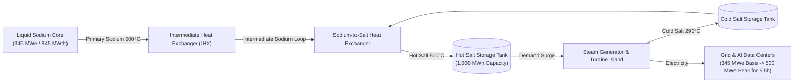

# Episode 08: Bill Gates' Natrium — Liquid Metal Reactors & The AI Energy Boom

  <h3 style="color: #00e5ff; margin-top: 0; display: flex; align-items: center; gap: 8px;">🧠 Interactive Knowledge Check (Pop Quiz #08)</h3>
  
Why can Bill Gates' Natrium reactor operate at 500°C at normal atmospheric pressure (1 atm), while standard water reactors must operate at 155 atmospheres?

  <ul style="list-style-type: none; padding-left: 0; margin: 15px 0;">
    <li style='padding: 8px 12px; margin-bottom: 6px; background: rgba(30, 41, 59, 0.6); border-radius: 6px; border: 1px solid rgba(255,255,255,0.08);'>[A] Elemental sodium has an 883°C boiling point and 100x higher thermal conductivity ✅</li>
    <li style='padding: 8px 12px; margin-bottom: 6px; background: rgba(30, 41, 59, 0.6); border-radius: 6px; border: 1px solid rgba(255,255,255,0.08);'>[B] Liquid sodium freezes under high pressure</li>
    <li style='padding: 8px 12px; margin-bottom: 6px; background: rgba(30, 41, 59, 0.6); border-radius: 6px; border: 1px solid rgba(255,255,255,0.08);'>[C] Natrium reactors operate in a total vacuum</li>
    <li style='padding: 8px 12px; margin-bottom: 6px; background: rgba(30, 41, 59, 0.6); border-radius: 6px; border: 1px solid rgba(255,255,255,0.08);'>[D] Light water is too heavy to circulate at high temperatures</li>
  </ul>
  

    
💡 Reveal Detailed Scientific Explanation & Timestamp

    

      <strong>Explanation:</strong> Elemental sodium boils at 883°C at 1 atm, providing an immense 383°C safety buffer without needing 12-inch forged steel pressure vessels! 
      <strong>Video Timestamp:</strong> Check <code>[07:37]</code> in the video for the mathematical derivation!
    

  

---

> **A Masterclass on Fast Neutron Spectrum Physics, Liquid Sodium Thermal Hydraulics, Gigawatt-Scale Molten Salt Thermal Storage, and HALEU Fuel Geopolitics.**

---

## 1. Executive Summary & The AI Energy Chokepoint

In 2024, global compute clusters crossed an unprecedented energetic threshold. Training frontier artificial intelligence models and operating hyperscale inference data centers consume electricity at an exponential rate. Current projections indicate data center demand will exceed **1,000 Terawatt-hours (TWh)** annually before 2030.

Intermittent renewables (solar and wind) suffer from low capacity factors (20–35%) and lack the physical inertia and 24/7 reliability demanded by silicon compute. Silicon Valley giants have thus pivoted toward nuclear power:
- **Microsoft**: 20-year Power Purchase Agreement (PPA) to restart Constellation's Three Mile Island Unit 1 (835 MWe).
- **Amazon Web Services (AWS)**: $650 Million acquisition of Talen Energy's Cumulus nuclear data center campus (up to 960 MWe) adjacent to the Susquehanna nuclear station.
- **Google**: Multi-reactor framework with Kairos Power for fluoride salt-cooled SMRs.
- **TerraPower & PacifiCorp**: Commercial groundbreaking on June 10, 2024, in Kemmerer, Wyoming, for the **345 MWe Natrium Liquid Sodium Fast Reactor**, co-funded by the US Department of Energy's Advanced Reactor Demonstration Program (ARDP).

---

## 2. The Thermodynamic Dilemma: Why Conventional Reactors Operate at 155 Atmospheres

Over 90% of global commercial nuclear power is generated by **Light Water Reactors (LWRs)**, primarily Pressurized Water Reactors (PWRs) and Boiling Water Reactors (BWRs).

### 2.1 The Saturation Pressure Trap
At standard atmospheric pressure ($1.013\text{ bar}$ / $1\text{ atm}$), water boils at $100^\circ\text{C}$. However, thermodynamic efficiency in a Rankine cycle scales with core outlet temperature $T_{\text{out}}$:
$$\eta_{\text{Carnot}} = 1 - \frac{T_{\text{cold}}}{T_{\text{hot}}}$$
To achieve a thermal efficiency of $\sim 33\%$, PWRs must heat coolant to $315^\circ\text{C}$ to $325^\circ\text{C}$. According to the Antoine and IAPWS-IF97 steam saturation formulations:
$$P_{\text{sat}}(315^\circ\text{C}) \approx 10.5\text{ MPa} \approx 104\text{ bar}$$
To prevent bulk boiling inside the core, commercial PWRs operate at:
$$P_{\text{primary}} = 15.5\text{ MPa} \approx 155\text{ atmospheres} \approx 2,250\text{ psi}$$

### 2.2 Engineering & Cost Penalties of High Pressure
1. **Massive Forged Steel Pressure Vessels**: Reactor pressure vessels (RPVs) require forged SA-508 Grade 3 low-alloy steel with wall thicknesses exceeding **200 to 300 mm (8 to 12 inches)**.
2. **Loss-of-Coolant Accident (LOCA) Hazards**: High pressure creates stored mechanical energy. A major guillotine pipe break results in violent flashing of high-enthalpy subcooled water into thousands of cubic meters of steam within seconds.
3. **Heavy Containment Structures**: Thick reinforced post-tensioned concrete containment domes (1.2 to 1.5 m thick) designed to contain peak pressure transients of $0.4\text{ to }0.5\text{ MPa}$.

---

## 3. Elemental Sodium as Coolant: Physics & Fluid Mechanics

Natrium eliminates the high-pressure paradigm by using liquid elemental sodium ($\text{Na}$, atomic number $Z=11$).

| Parameter | Light Water ($H_2O$ at $155\text{ bar}$) | Liquid Sodium ($Na$ at $1\text{ bar}$) | Advantage Ratio |
| :--- | :--- | :--- | :--- |
| **Melting Point** | $0^\circ\text{C}$ | $97.8^\circ\text{C}$ | Liquid metal at operational temps |
| **Boiling Point** | $100^\circ\text{C}$ (at 1 atm) | **$883^\circ\text{C}$** | **$383^\circ\text{C}$ thermal margin at 1 atm** |
| **Operating Pressure** | **$15.5\text{ MPa}$ ($155\text{ atm}$)** | **$0.1\text{ MPa}$ ($1\text{ atm}$)** | **Zero high-pressure driving force** |
| **Thermal Conductivity ($k$)** | $0.55 - 0.65\text{ W}/(\text{m}\cdot\text{K})$ | **$68 - 72\text{ W}/(\text{m}\cdot\text{K})$** | **$\sim 110\times$ superior heat conduction** |
| **Density ($\rho$)** | $\sim 720\text{ kg}/\text{m}^3$ (at $315^\circ\text{C}$) | $\sim 850\text{ kg}/\text{m}^3$ (at $500^\circ\text{C}$) | High fluid density |
| **Kinematic Viscosity ($\nu$)** | $1.2 \times 10^{-7}\text{ m}^2/\text{s}$ | $3.2 \times 10^{-7}\text{ m}^2/\text{s}$ | Flows like water |

### 3.1 Heat Transfer & Nusselt Number
In liquid metals, the Prandtl number is extraordinarily low:
$$\text{Pr} = \frac{\nu}{\alpha} = \frac{\mu c_p}{k} \approx 0.005$$
Because thermal diffusivity $\alpha$ dwarfs kinematic viscosity $\nu$, heat conducts across fluid streamlines far faster than momentum diffuses. Liquid metal convective heat transfer inside rod bundles is governed by the Lyon-Martinelli and Subbotin correlations:
$$\text{Nu} = 5.0 + 0.025 \cdot \text{Pe}^{0.8}$$
where $\text{Pe} = \text{Re} \cdot \text{Pr}$ is the Péclet number. This enables immense volumetric heat removal rates with minimal fuel-cladding temperature drops.

---

## 4. Fast Neutron Physics & Transmutation

### 4.1 Absence of Elastic Moderation
When a neutron undergoes an elastic collision with a target nucleus of mass number $A$, the maximum fractional energy loss is:
$$\xi = 1 + \frac{(A-1)^2}{2A}\ln\left(\frac{A-1}{A+1}\right)$$
- For Hydrogen ($A=1$): $\xi = 1.000$ (complete momentum transfer; thermalizes in $\sim 18$ collisions).
- For Sodium ($A=23$): $\xi \approx 0.084$ (minimal energy loss; requires $>1,000$ collisions to slow down).

Consequently, the neutron energy spectrum in Natrium peaks between **$100\text{ keV}$ and $1\text{ MeV}$**, maintaining a **Fast Neutron Spectrum**.

### 4.2 Fission-to-Capture Ratio & Actinide Burning
At fast neutron energies, the ratio of fission cross section $\sigma_f$ to radiative capture cross section $\sigma_\gamma$ increases drastically:
$$\alpha = \frac{\sigma_\gamma}{\sigma_f} \ll 1$$
This enables the direct threshold fission of fertile isotopes such as Uranium-238 ($\text{U-238}$) and minor actinides (Neptunium-237, Americium-241, Curium-244):
$$\text{n}_{\text{fast}} + {}^{238}_{\ 92}\text{U} \longrightarrow \text{Fission Products} + (2.6)\text{ n} + 200\text{ MeV}$$
Fast reactors can extract over **60 times more energy** from natural uranium than LWRs while dramatically reducing the geological radiotoxicity lifespan of nuclear waste from **300,000 years to under 400 years**.

---

## 5. The Gigawatt-Hour Molten Salt Thermal Energy Storage

### 5.1 Decoupling the Nuclear Island from Grid Fluctuations
Conventional nuclear reactors operate under constant baseload regimes due to fuel temperature coefficients and thermal fatigue on thick pressure boundary components. Natrium decouples nuclear power from the grid:
- **Nuclear Island**: Continuous, unperturbed $100\%$ thermal operation ($845\text{ MWth}$).
- **Energy Storage Island**: Two-tank molten nitrate salt system ($60\%\ \text{NaNO}_3 + 40\%\ \text{KNO}_3$, "solar salt") holding $>30,000$ metric tons of liquid salt.
  - Cold Tank Temperature: $290^\circ\text{C}$
  - Hot Tank Temperature: $500^\circ\text{C}$
  - Stored Energy Capacity: $\sim 1,000\text{ MWh}_{\text{th}}$

---

## 6. Passive Inherent Safety: Walk-Away Physics

### 6.1 Reactor Vessel Auxiliary Cooling System (RVACS)
Decay heat removal operates without AC power, diesel generators, pumps, or operator action:
1. Natural air circulation is driven by buoyancy within an annular gap surrounding the containment guard vessel.
2. The mass flow rate of cooling air automatically increases as vessel temperature rises:
$$\dot{m}_{\text{air}} \propto \sqrt{\frac{g \cdot \Delta \rho \cdot H}{R_{\text{flow}}}}$$
3. Decay heat is radiated from the reactor vessel wall across an inert argon gap to the guard vessel, where air chimney draft vents heat directly to the atmosphere.

### 6.2 The Historic 1986 EBR-II Validation
On April 3, 1986, at Idaho National Laboratory, researchers subjected **Experimental Breeder Reactor II (EBR-II)** to two severe unprotected transients:
1. **Unprotected Loss of Flow (ULOF)**: Coolant pumps turned off at 100% full power with all scram mechanisms disabled.
2. **Unprotected Loss of Heat Sink (ULOHS)**: Secondary cooling halted completely.

In both tests, core thermal expansion and negative Doppler broadening ($\alpha_D < 0$) automatically choked off reactivity within 300 seconds. Peak temperatures remained hundreds of degrees below structural limits, and natural sodium convection removed all decay heat without fuel damage.

---

## 7. The Geopolitical Chokepoint: HALEU Fuel Supply Chain

Natrium's primary commercial constraint is not engineering—it is the availability of **High-Assay Low-Enriched Uranium (HALEU)** enriched between **$5.0\%\text{ and }19.75\%\ \text{U-235}$**.

### 7.1 The Russian Monopoly & The 2022 Crisis
Prior to 2022, Russia's state-owned nuclear corporation **Rosatom** (via subsidiary Tenex) operated the world's only commercial-scale HALEU centrifuge cascades. Following the Russian invasion of Ukraine, Western supply agreements dissolved, forcing TerraPower to postpone Natrium's commercial in-service date from **2028 to 2030**.

### 7.2 The American Centrifuge Mobilization
The US DOE initiated the HALEU Availability Program under the Energy Act of 2020:
- **Centrus Energy (Piketon, Ohio)**: Deployed American Centrifuge cascades, producing commercial HALEU in late 2023.
- **Urenco (Eunice, New Mexico)** and **Orano (France)**: Scaling multi-billion-dollar domestic centrifuge expansion projects to establish full Western fuel autonomy by 2028–2030.

---

## 8. Summary Technical Specifications

- **Reactor Type**: Sodium-Cooled Fast Reactor (SFR), Pool-Type
- **Thermal Power**: $845\text{ MWth}$
- **Continuous Electric Power**: $345\text{ MWe}$
- **Peak Discharging Electric Power**: $500\text{ MWe}$ (for 5.5 hours)
- **Primary Coolant**: Liquid Sodium ($0.1\text{ MPa}$, Core inlet $360^\circ\text{C}$, Core outlet $500^\circ\text{C}$)
- **Fuel**: Metallic U-Pu-Zr alloy or oxide fuel with HALEU ($19.75\%\ \text{U-235}$)
- **Thermal Efficiency**: $41\%$ (vs $33\%$ in LWRs)
- **Primary Safety Feature**: RVACS (Passive Air Natural Circulation) + Negative Doppler Feedback
- **Site**: Kemmerer, Lincoln County, Wyoming (adjacent to PacifiCorp's Naughton Coal Plant)
