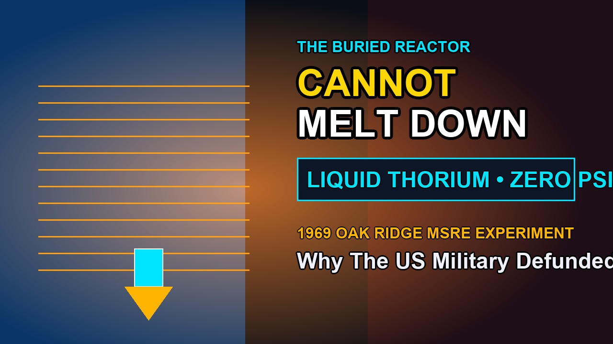

# 🔬 Episode 11: The Thorium Conspiracy — Why The Molten Salt Reactor Was Abandoned

  Theoretical Physics Masterclass
  <h2 style="margin: 10px 0 6px 0; color: #f8fafc;">The 1969 Walk-Away Reactor & Liquid Fluoride Chemistry</h2>
  
How Alvin Weinberg's Molten Salt Reactor Experiment (MSRE) achieved passive gravity freeze-plug safety and 100% Thorium-232 fuel utilization without high-pressure vessels.

---

## 📺 Video Overview & Concept

  

---

## 🧠 Interactive Pop Quiz: Thorium Breeding Physics

  <h3 style="color: #00e5ff; margin-top: 0;">❓ POP QUIZ: Why Did The Military Prefer Uranium Over Thorium in the 1960s?</h3>
  
Thorium-232 is 4x more abundant than Uranium and cannot undergo explosive pressure breaches. Why did the Cold War defense apparatus cancel it in 1973?

  
  

    
👉 Click to Reveal Scientific Answer & Decay Chain

    

      
<strong>Correct Explanation:</strong>

      
1. <strong>Uranium-232 Contamination:</strong> The Thorium-Uranium breeding cycle inevitably produces trace amounts of $^{232}\text{U}$, whose decay daughter $^{208}\text{Tl}$ emits a blistering 2.6 MeV gamma ray. This high radiation field fries electronic weapon detonators and is lethal to weapons-handling personnel.

      
2. <strong>Zero Plutonium Breeding:</strong> Thorium reactors do not breed weapon-grade $^{239}\text{Pu}$, making them useless for Cold War nuclear arsenal expansion.

    

  

---

## ⚡ Mathematical Equations of the Thorium Cycle

$$\Sigma_a(^{232}\text{Th}) + n_{\text{th}} \longrightarrow ^{233}\text{Th} \xrightarrow[\beta^-]{22.3\text{ m}} ^{233}\text{Pa} \xrightarrow[\beta^-]{26.97\text{ d}} ^{233}\text{U}$$

$$\alpha_T = \frac{d\rho}{dT} < 0 \quad (\text{Passive Thermal Expansion})$$
