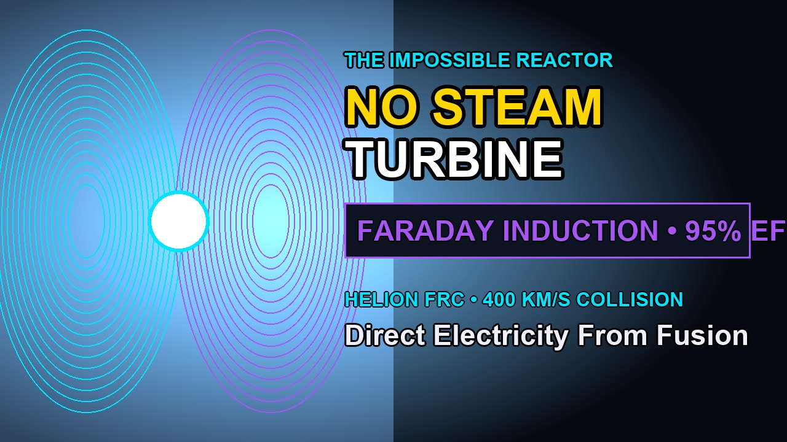

# ⚡ Episode 12: Direct Fusion Energy — How Helion Generates Electricity Without Steam Turbines

  Theoretical Physics Masterclass
  <h2 style="margin: 10px 0 6px 0; color: #f8fafc;">Bypassing The Steam Cycle: Faraday Electromagnetic Induction</h2>
  
How Field-Reversed Configuration (FRC) plasmoids colliding at 400 km/s fuse Deuterium and Helium-3 to directly recapture electricity at over 95% efficiency.

---

## 📺 Video Overview & Concept

  

---

## 🧠 Interactive Pop Quiz: Direct Inductive Conversion

  <h3 style="color: #00e5ff; margin-top: 0;">❓ POP QUIZ: Why Does D-He3 Fusion Allow Direct Energy Recovery?</h3>
  
Why can't standard Deuterium-Tritium (D-T) fusion reactors like ITER or NIF use electromagnetic coils to directly harvest electricity?

  
  

    
👉 Click to Reveal Scientific Answer

    

      
<strong>Correct Explanation:</strong>

      
1. <strong>Neutron Carry-Away in D-T:</strong> In D-T fusion, 80% of the energy is carried away by uncharged 14.1 MeV neutrons. Neutrons cannot interact with magnetic fields, so their kinetic energy can only be converted to heat via water blankets.

      
2. <strong>Charged Products in D-He3:</strong> D-He3 fusion produces charged alpha particles ($^4\text{He}^{2+}$) and protons ($p^+$). These charged ions expand against the magnetic field, inducing current in external coils via Faraday's Law ($\mathcal{E} = -d\Phi_B/dt$) with zero steam turbines.

    

  

---

## ⚡ Mathematical Equations of Direct Inductive Fusion

$$\text{D} + ^3\text{He} \longrightarrow ^4\text{He}\ (3.6\text{ MeV}) + p^+\ (14.7\text{ MeV})$$

$$\mathcal{E} = -\frac{d\Phi_B}{dt} = -A \frac{dB}{dt} \quad (\text{Inductive Current Recapture})$$
