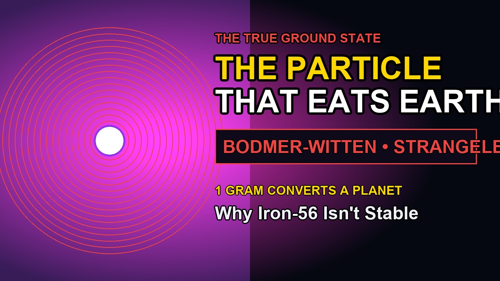

# 🌌 Episode 13: Strange Stars & Strangelets — The Particle That Could Eat The Earth

  Extreme Quantum Astrophysics
  <h2 style="margin: 10px 0 6px 0; color: #f8fafc;">The Bodmer-Witten Hypothesis & Quark Matter Contagion</h2>
  
Is Iron-56 truly the most stable nucleus in existence, or does three-flavor quark matter (up, down, strange) represent the true cosmological ground state?

---

## 📺 Video Overview & Concept

  

---

## 🧠 Interactive Pop Quiz: The Strangelet Hazard

  <h3 style="color: #ff3d00; margin-top: 0;">❓ POP QUIZ: Can A Subatomic Strangelet Really Convert Earth Into Quark Matter?</h3>
  
If strange quark matter has lower energy per baryon than Iron-56 (E/A < 930 MeV), why hasn't a cosmic ray strangelet converted our planet yet?

  
  

    
👉 Click to Reveal Quantum Chromodynamics Solution

    

      
<strong>Theoretical Resolution:</strong>

      
1. <strong>Coulomb Repulsion:</strong> Positively charged strangelets are electrostatically repelled by ordinary nuclei. Only negatively charged strangelets could bypass the Coulomb barrier at thermal velocities.

      
2. <strong>Cosmic Ray Flux Limits:</strong> The Moon and other airless bodies have been bombarded by ultra-high-energy cosmic rays for 4.5 billion years without collapsing, putting an empirical upper bound on stable strangelet production.

    

  

---

## ⚡ Fundamental QCD Relations

$$\frac{E}{A}(u, d, s) < \frac{E}{A}(^{56}\text{Fe}) \approx 930.4\text{ MeV}$$

$$\rho_{\text{strange}} \sim 4 \times 10^{14}\text{ g/cm}^3 \quad (\text{Above Nuclear Saturation Density})$$
