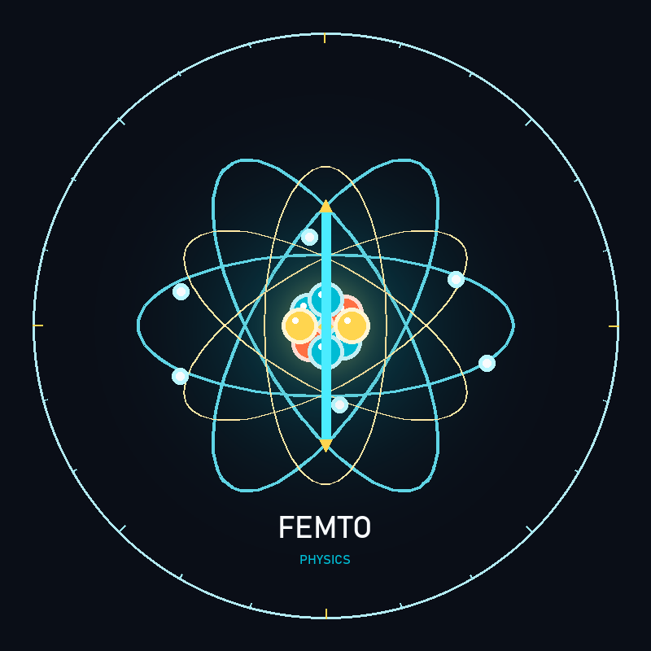

# 👤 About the Producer & Production Pipeline

  

## 🔬 Channel Leadership
**Femto Physics** was conceived, directed, and engineered by:

### **Soumyadeep Sarkar**
- **GitHub Profile**: [@soumyadeepsarkar-2004](https://github.com/soumyadeepsarkar-2004)
- **Role**: Executive Producer, Computational Physics Architect & Animator
- **Contact**: `contact@femtophysics.org` / GitHub Issues

---

## 🛠️ The Production Pipeline
Every episode of Femto Physics is synthesized through an uncompromising computational pipeline:

1. **Theoretical Derivations**:
   Differential equations, balance laws, and neutron transport equations solved analytically or numerically.
2. **Nuclear Cross-Section Grounding**:
   Microscopic cross-sections ($\sigma_\gamma, \sigma_f, \sigma_s$) queried from evaluated databases (ENDF/B-VIII.0) to ensure zero mathematical hand-waving.
3. **Motion Graphics & Simulation**:
   Custom Python scripts using Matplotlib, PIL, and OpenCV generating 60fps scientific visuals rendered in the signature obsidian/cyan color scheme.
4. **Authentic Archival Footage**:
   Declassified test facility documentation (EBR-II, Superphénix, Oak Ridge, Los Alamos Godiva, and Cloud Chambers).
5. **Audience Community**:
   Every derivation and visual asset is documented here on GitHub for students, researchers, and nuclear enthusiasts worldwide.

---

[⬅️ Back to Master Documentation](README.md)
