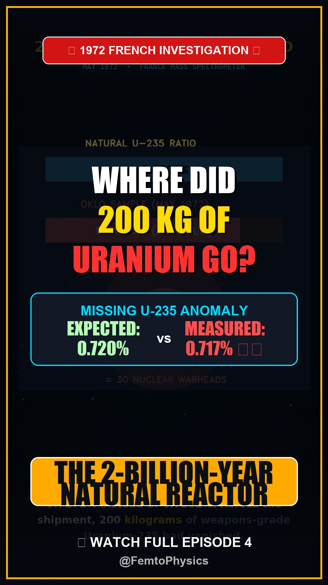

# ⚡ Short 01: The French Military's 200kg Uranium Mystery

  

  <a class="yt-card" href="https://youtube.com/shorts/90WGyd0FVlM" target="_blank">▶ Watch Short on YouTube</a>

---

## 🔬 The 60-Second Physics Breakdown
In May 1972, during routine mass spectrometry analysis at the Pierrelatte uranium enrichment facility in France:
- The measured concentration of Uranium-235 was $0.7171\%$ instead of the natural $0.7202\%$.
- A total deficit of over 200 kg of pure fissile material was missing from raw ore originating in the Oklo mine in Gabon, West Africa.
- French intelligence feared a clandestine nuclear weapons program had diverted weapons-grade feed material.

Subsequent investigations proved that **2 billion years ago**, natural groundwater seeped into concentrated ore bodies ($3.67\%$ primordial U-235), creating 16 natural fission reactor zones that safely operated in cyclical pulses for hundreds of thousands of years.

Watch the full deep-dive derivation on **[Episode 4: Oklo Natural Nuclear Reactor](ep04-oklo-natural-reactor.md)**.
